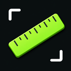
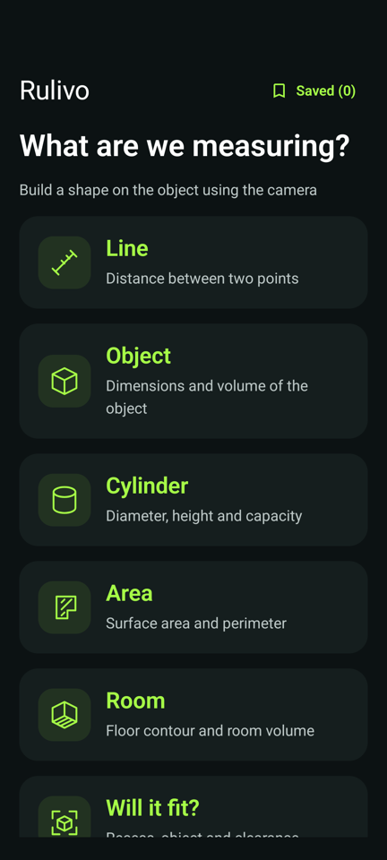
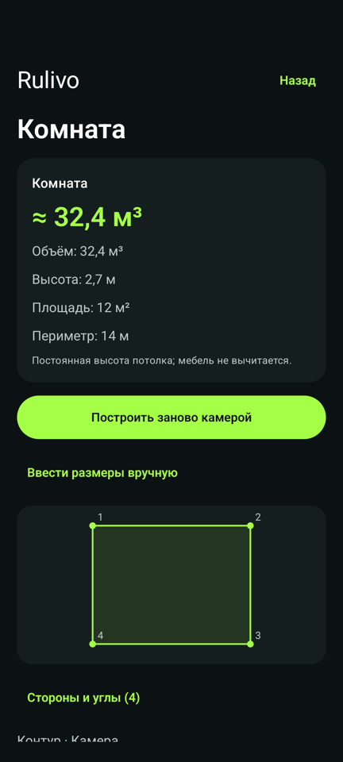
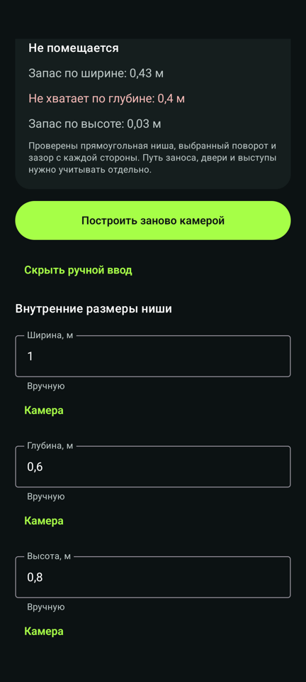
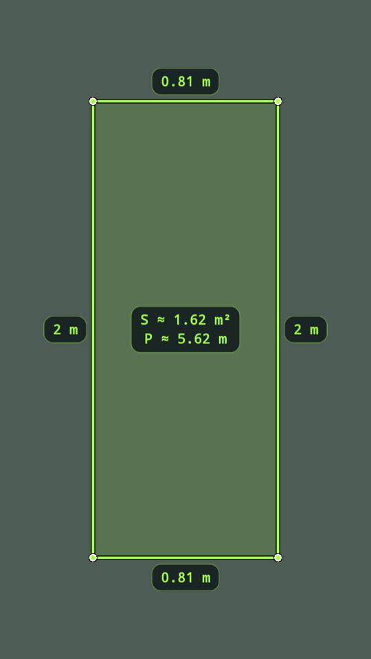
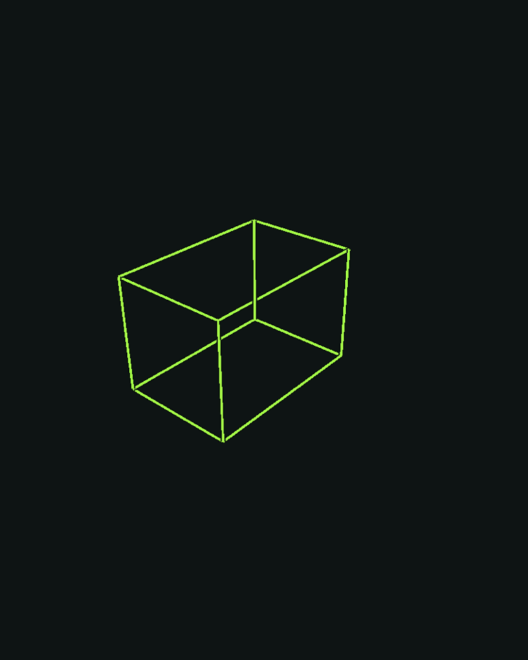
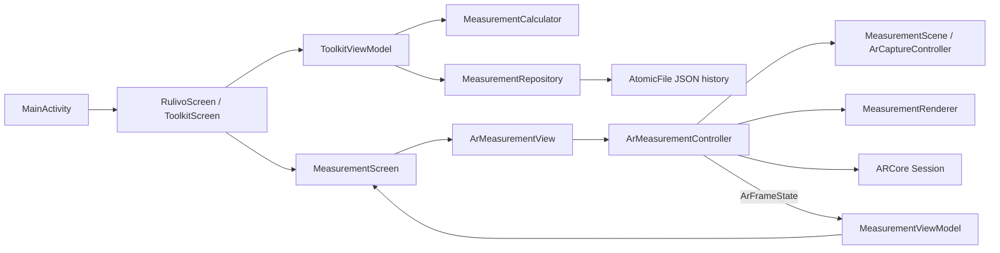

# Rulivo · AR Measure



An Android measurement toolkit for turning camera observations into distances, surface areas, volumes, fit checks, and material estimates. Users can build a shape in AR, refine its dimensions, and keep the result with its original inputs and measurement sources.

[Google Play](https://play.google.com/store/apps/details?id=com.ilya.rulivo) · `com.ilya.rulivo` · Android 7.0+ · Kotlin / Compose / ARCore / OpenGL ES

## In the app

| Choose a measurement | Inspect a room result | Check an object against a space |
| :---: | :---: | :---: |
|  |  |  |

These are existing Android UI captures from the project's QA runs. The Russian result screens show an earlier UI localization. [Image provenance](docs/portfolio/README.md) identifies the original files; no interface was invented for this portfolio.

## Capabilities

| Workflow | Implemented behavior |
| --- | --- |
| **Lines and connected contours** | Keep up to 30 completed segments in one live AR scene, preview the next segment, continue a line around corners, and close a planar contour. Display side lengths, area, and perimeter in the camera view. Undo a segment, cancel an unfinished point, or clear the scene. |
| **Objects and cylinders** | Build a base with camera points, then adjust height by camera aiming, a numeric value, or ±5 cm steps. Update the wireframe and volume immediately; distinguish outer dimensions from internal capacity. Display m³, litres, or cm³. |
| **Surface area and rooms** | Capture a floor or surface outline, including concave contours with up to 32 corners. Replace individual points, close the outline, and add room height. Manual rectangular and L-shaped inputs are also available. |
| **Will it fit?** | Capture the available space and object in sequence. Apply clearance on each side, evaluate base rotations and optional tipping, and show remaining space or shortage per axis. |
| **Materials** | Calculate flooring packs, paint from coverage and coat count, or baseboard pieces after excluded lengths. Transfer area and perimeter from a measurement without display rounding. |
| **Saved measurements** | Store the name, date, inputs, input sources, outline, and numerical result locally. Open a result, create an editable copy, or share a text report through Android's share sheet. |
| **Languages** | Switch between English, Indonesian, Urdu, Hausa, and Hindi offline. Urdu uses RTL; numeric input accepts Latin, Devanagari, and Arabic digits. |

The mode menu and manual calculations are available without camera permission. The camera session starts when a camera workflow is opened and pauses when returning to the toolkit. Live AR lines remain available while that session survives; saved toolkit results are separate persistent records.

## Engineering decisions

### Keep AR resources under one owner

ARCore frames and anchors must remain consistent with the renderer and Android lifecycle. [`ArMeasurementController`](app/src/main/java/com/ilya/rulivo/ar/ArMeasurementController.kt) owns the session, processes scene changes on the GL thread, and publishes detached [`ArFrameState`](app/src/main/java/com/ilya/rulivo/ar/ArFrameState.kt) snapshots back to the main thread. ViewModels hold UI values rather than `Session`, `Frame`, or `Anchor` objects.

The line controller accepts one pending command through `AtomicReference`. Commands carry a scene revision, so delayed taps cannot mutate a newer scene. [`CaptureCommands` and `CaptureDraft`](app/src/main/java/com/ilya/rulivo/ar/CaptureDraft.kt) preserve figure-edit command order and coalesce consecutive height edits within the same structural revision. Anchor factories are called only after request, revision, surface, and budget checks pass.

Pause waits for `GLSurfaceView` before pausing ARCore. Disposal releases anchors, invalidates pending availability callbacks with a generation counter, and closes the session on a separate thread. These boundaries reduce races between rendering, Activity transitions, asynchronous AR availability checks, and rapid input.

### Gate measurements on actual tracked surfaces

The center hit-test accepts tracked, front-facing `Plane` hits inside the plane polygon or `DepthPoint` hits. [`SurfaceHitSelection`](app/src/main/java/com/ilya/rulivo/ar/SurfaceHitSelection.kt) chooses the nearest valid hit and prefers a fitted plane only within 2 cm of that depth, avoiding a wall or floor behind the target. Automatic Depth is enabled only when the device supports it; the fallback uses planes.

[`SpaceScanTracker`](app/src/main/java/com/ilya/rulivo/ar/SpaceScanTracker.kt) requires 12 distinct surface frames and 800 ms of observation before initial measurement. It rejects stale camera timestamps, preserves preparation progress during interruptions, and requires fresh recovery frames before continuing. This is a readiness heuristic, not a room-mapping percentage or an accuracy guarantee. Placement is rechecked against the current frame before anchor creation; there is no artificial dwell at each target.

### Make 3D geometry usable without requiring a hit on every derived corner

[`ArCaptureController`](app/src/main/java/com/ilya/rulivo/ar/ArCaptureController.kt) keeps real surface anchors separate from computed corners. [`FigureGeometry`](app/src/main/java/com/ilya/rulivo/ar/FigureGeometry.kt) derives boxes, cylinders, and room wireframes in a local coordinate basis. [`CameraHeightMotion`](app/src/main/java/com/ilya/rulivo/ar/CameraHeightMotion.kt) intersects the camera ray with a fixed vertical drag plane, allowing height adjustment without finding the object's top surface. Input-source metadata distinguishes camera points, camera aiming, manual values, and derived values.

For connected contours, [`ContourGeometry`](app/src/main/java/com/ilya/rulivo/ar/ContourGeometry.kt) projects 3D points onto an orthonormal plane, validates the resulting polygon, and uses ear clipping to render concave fills. It selects an interior triangle for the area label when a concave polygon's centroid falls outside. [`PolygonGeometry`](app/src/main/java/com/ilya/rulivo/measure/Geometry.kt) rejects repeated corners, overlapping edges, self-intersections, and degenerate area; area computation translates coordinates near the origin to reduce cancellation.

| Connected contour rendering | Derived object wireframe |
| :---: | :---: |
|  |  |

These images are output from the application's renderer tests using deterministic geometry and a synthetic background. They demonstrate rendering behavior, rather than physical measurement accuracy.

[`MeasurementRenderer`](app/src/main/java/com/ilya/rulivo/ar/MeasurementRenderer.kt) draws the camera texture, lines, markers, plane grids, fills, and captions with OpenGL ES 2.0. Captions project each segment's actual 3D midpoint, choose a visible offset near screen edges, and avoid contour-label bounds. Label textures are reused until their text changes and deleted when their scene IDs disappear, including during tracking loss. Preview movement creates no additional ARCore anchor.

### Preserve user data across failed writes and language changes

[`ToolkitViewModel`](app/src/main/java/com/ilya/rulivo/ui/measurement/ToolkitViewModel.kt) stores drafts in `SavedStateHandle`, serializes history operations with a coroutine `Mutex`, and performs file I/O on `Dispatchers.IO`. [`MeasurementRepository`](app/src/main/java/com/ilya/rulivo/measure/MeasurementRepository.kt) uses `AtomicFile` replacement so a failed write can retain the last successful history. A read failure disables further saves instead of overwriting unreadable data with an empty history.

History schema 2 persists stable enum names, numeric results, outlines, and user inputs rather than translated result text. Presentation is derived again in the selected language; schema 1 files remain readable. The [`localization checker`](tools/localization/LocalizationCheck.java) runs before Android builds and checks translation coverage, format arguments, and common hardcoded UI text. Its regression suite is part of Gradle `check`. See [localization design and verification notes](docs/LOCALIZATION.md).

### Keep diagnostics away from the render loop

The optional debug [`DiagnosticJournal`](app/src/main/java/com/ilya/rulivo/ar/DiagnosticJournal.kt) writes detached JSONL snapshots on a dedicated thread using a bounded 256-event queue, an 8 MiB session limit, and five-session retention. Queue overflow is counted; write failures disable logging without stopping measurement. The journal does not capture camera images and is off by default. [Export and analysis tools](tools/accuracy) and the [physical test protocol](docs/accuracy/PROTOCOL.md) separate observed tracking, failed attempts, and measurement error from assumptions about accuracy.

### Make the optional support service an explicit user choice

The bundled Dunta SDK integration offers optional network-resource sharing through a consent dialog and settings switch. [`DuntaSdkController`](app/src/main/java/com/ilya/rulivo/core/dunta/DuntaSdkController.kt) coordinates consent, notification permission, and saved choice; disabling stops the SDK and cancels recovery jobs. [`SupportModeRecoveryWorker`](app/src/main/java/com/ilya/rulivo/core/dunta/SupportModeRecoveryWorker.kt) uses unique WorkManager jobs for unmetered networking or connected networking while charging, with a shared restart mutex and renewed consent/configuration checks. Recovery is scheduled only when battery optimization exemption is enabled. See [integration details](docs/dunta-sdk-integration.md).

## Architecture

One Android application module combines Compose screens, ViewModels, an explicitly owned AR controller, and a local calculation/history package. Screen navigation is represented by toolkit page and camera-visibility state. Dependencies are constructed directly: the Activity obtains ViewModels, `ToolkitViewModel` receives a repository with a file-backed default, and `RulivoApplication` owns the support controller. There is no DI framework.



A camera request carries an ID and target field. The controller validates the live capture, produces a `CaptureResult`, and the toolkit accepts it only when the request ID still matches. The calculator then derives the displayed result from the updated draft. `StateFlow` and `collectAsStateWithLifecycle` connect ViewModels to Compose; live anchors stay within the view/controller lifetime rather than being restored as world coordinates after process death.

### Stack used in the code

| Technology | Role |
| --- | --- |
| Kotlin 2.2.10, Jetpack Compose, Material 3 | UI, forms, state rendering, drawing, and camera-guidance animations. |
| AndroidX Lifecycle / ViewModel 2.10.0, coroutines / StateFlow | Lifecycle-aware state collection, retained drafts, and serialized asynchronous history operations. |
| ARCore 1.56.0 | Camera pose, horizontal/vertical plane detection, optional automatic Depth, hit-tests, and anchors. |
| Android OpenGL ES 2.0, `GLSurfaceView`, Canvas | Camera rendering, geometry, and cached caption textures. |
| AndroidX AppCompat 1.7.1 | Activity integration and persisted per-app language selection. |
| WorkManager 2.10.0 and bundled Dunta AAR | Constrained recovery of the optional support service. |
| JUnit 4, AndroidX Test, Compose UI tests | Geometry/state tests and Android UI, persistence, locale, and renderer checks. |

Versions and supporting SDK dependencies are in the [version catalog](gradle/libs.versions.toml) and [app build configuration](app/build.gradle.kts). The application does not implement a measurement backend or cloud history sync. Optional support mode has separate networking behavior.

## Code map

| Path | Responsibility |
| --- | --- |
| [`app/src/main/java/com/ilya/rulivo/ar`](app/src/main/java/com/ilya/rulivo/ar) | AR lifecycle, command handling, scene ownership, geometric capture, renderer, and diagnostics. |
| [`app/src/main/java/com/ilya/rulivo/measure`](app/src/main/java/com/ilya/rulivo/measure) | Typed drafts, calculations, polygon validation, input provenance, and history persistence. |
| [`app/src/main/java/com/ilya/rulivo/ui`](app/src/main/java/com/ilya/rulivo/ui) | Compose toolkit/camera screens, ViewModels, guidance, and theme. |
| [`app/src/main/java/com/ilya/rulivo/i18n`](app/src/main/java/com/ilya/rulivo/i18n) | Language selection, resource lookup, and localized numbers. |
| [`app/src/main/java/com/ilya/rulivo/core/dunta`](app/src/main/java/com/ilya/rulivo/core/dunta) | SDK adapter, consent/settings UI, notifications, and recovery scheduling. |
| [`app/src/main/java/com/ilya/rulivo/permissions`](app/src/main/java/com/ilya/rulivo/permissions) | Camera permission requests, permanent-denial handling, and settings return checks. |
| [`app/src/test`](app/src/test) / [`app/src/androidTest`](app/src/androidTest) | JVM and Android test sources. |
| [`docs/features`](docs/features) / [`docs/accuracy`](docs/accuracy) / [`tools`](tools) | Implementation notes, QA protocols, localization checks, and accuracy analysis scripts. |

## Build and run

| Requirement | Project configuration |
| --- | --- |
| Gradle JDK | 21, pinned in [`gradle-daemon-jvm.properties`](gradle/gradle-daemon-jvm.properties). Java source/target compatibility is 11 with core-library desugaring. |
| Gradle / Android Gradle Plugin | Wrapper 9.1.0 / AGP 9.0.0. Use an Android Studio version that supports AGP 9.0.0. |
| Android SDK | Compile and target API 36; minimum API 24. |
| Device for AR | ARCore-compatible physical device with Google Play Services for AR, a rear camera, and OpenGL ES 2.0. Depth is optional. |

Open this directory in Android Studio and sync, or run the wrapper from this directory. Configure your SDK path in untracked `local.properties` (`sdk.dir=...`) and accept the required Android SDK licenses. The build expects the bundled `app/libs/dunta_sdk-release.aar`.

```sh
./gradlew :app:checkLocalization :app:testLocalizationCheck
./gradlew :app:testDebugUnitTest :app:assembleDebug :app:lintDebug
adb install -r app/build/outputs/apk/debug/app-debug.apk
adb shell am start -n com.ilya.rulivo/.MainActivity
```

Optional support mode reads `DUNTA_PARTNER_ID` and `DUNTA_APPLICATION_ID` from Gradle properties or `local.properties`; Gradle properties take precedence. Missing values default to zero and disable activation. Obtain valid values from the SDK provider for that integration; do not add local configuration or signing material to version control. The AR measurement flow does not require an ARCore API key.

The [manifest](app/src/main/AndroidManifest.xml) declares AR as required. On a supported device, the app checks service availability and invokes ARCore's official installation/update flow when needed. Camera permission is requested for camera workflows and checked again on resume after visiting Android settings. Android 13+ notification permission is handled separately for optional support mode.

## Verification and boundaries

On **1 November 2026**, `:app:assembleDebug` and `:app:testDebugUnitTest` completed successfully in this working checkout: **146 JVM tests**, zero failures or errors. `:app:checkLocalization` and `:app:testLocalizationCheck` also passed. Gradle used incremental build caches. No emulator or physical device was connected; instrumented and hardware-dependent checks were not run.

The source includes targeted JVM tests for scene revisions and anchor ownership, scan freshness/recovery, hit selection, contour validation, figure geometry, height edits, formatting, localization, and bounded diagnostic writing. Android tests cover repository behavior, Compose overlays, large text/orientation cases, rendering, locale switching/RTL, and support-mode consent. With a connected test device or emulator, Android checks can be run with:

```sh
./gradlew :app:assembleDebugAndroidTest :app:connectedDebugAndroidTest
python3 -m unittest discover -s tools/accuracy/tests
```

Existing feature and localization documents contain dated QA results. They describe those runs; the included screenshots and renderer tests do not establish physical AR accuracy. See the [accuracy status](docs/accuracy/STATUS.md) for the distinction between implemented instrumentation and measurements still awaiting collection.

- Measurements are approximate and depend on tracking, lighting, visible texture, device support, and anchor drift. No physical accuracy tolerance is established here.
- Room volume assumes a constant ceiling height and includes furniture. A fit result checks a rectangular space and selected orientation; doors, protrusions, and the route into the room require separate assessment.
- The scan gate prepares the current AR session; it does not reconstruct a complete room. Live anchors are not persisted across process death.
- The app does not save camera photos or videos. Local history stores numerical results and input metadata; system backup is governed by the checked-in backup rules.
- SDK-provider registration and long-running support-service behavior on physical devices are outside the existing integration verification. Translation catalogs have automated coverage checks; native-speaker editorial review remains a separate task.

Further implementation notes: [measurement modes](docs/features/IMPLEMENTATION.md), [connected contours](docs/features/CONNECTED_CONTOURS.md), [height controls](docs/features/HEIGHT_CONTROLS.md), [scan and recovery guidance](docs/features/SCAN_GUIDANCE.md), and [camera-motion guidance](docs/features/CAMERA_MOTION.md). The [original mode specification](docs/features/MEASUREMENT_MODES.md) also contains exploratory ideas and should not be read as a list of shipped features.

[Portfolio index](https://github.com/ILYAPROKOFEV101/Android-Portfolio)
